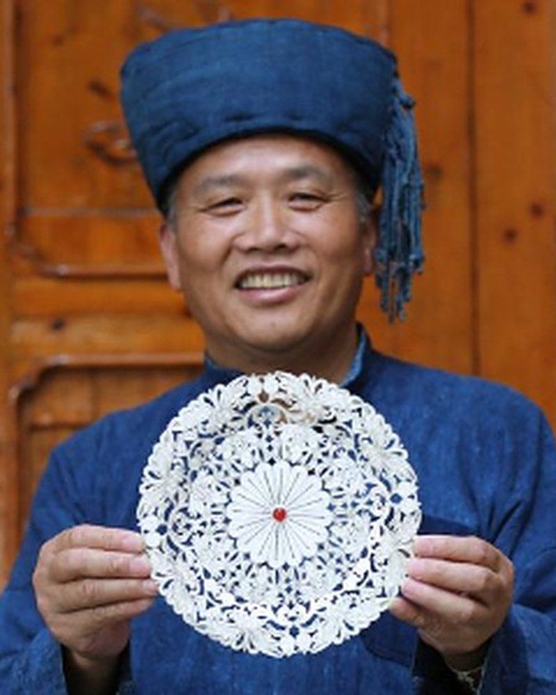

# 09 · 「匠心传承」页面交付说明

> 新增第四个板块：`inheritors.html`
> 提交 `d77787d`　｜　2026-11-08

---

## 一、这页做了什么

按你给的参考版式做了三张人物卡：**圆形头像 → 姓名 → 朱红头衔 → 一段小传**，横向并排。
配色、纸底、颗粒、面包屑、页头、页脚全部沿用「银绣珍藏」「枫启长歌」那一套，不做第二套语言。

页面放在顶栏第四个位置：**首页 / 历史溯源 / 纹样图鉴 / 匠心传承 / 互动创作**。

---

## 二、三位传承人

三个人各代表一项核心技艺，正好对上站名里的「银」「绣」和靛蓝底色的「染」。

| 姓名 | 头衔 | 项目 / 地区 / 批次 |
|---|---|---|
| 杨光宾 | 苗族银饰锻制技艺国家级传承人 | Ⅷ-40 · 贵州雷山 · 第一批（2007） |
| 王启萍 | 苗绣（花溪苗绣）国家级传承人 | Ⅶ-22 · 贵州贵阳 · 第五批（2018） |
| 杨芳 | 苗族蜡染技艺国家级传承人 | Ⅷ-25 · 贵州丹寨 · 第五批（2018） |

资料核对自中国非物质文化遗产网（ihchina.cn，文化和旅游部主管）的「国家级非物质文化遗产代表性项目代表性传承人」名录与人物条目。**页面上没有标注来源**，页脚只留了一句「手艺在人 · 人在山间」。

写进卡片的都是官方条目里的事实，没有自行发挥：

- **杨光宾**：雷山西江控拜银匠世家第五代；13 岁随父学艺、15 岁出师；熔炼/铸型/锻制/拉丝/焊接/錾刻/编结/洗涤三十余道工序；能把银锭锤成细如发丝再编成蝴蝶。
- **王启萍**：7 岁随母学绣、12 岁掌握基本技艺；拜王朝珍为师习挑花绣；十字为基本针法、不用底稿、数纱而绣；「反面挑正面看」；代表作《苗族妇女盛装》《娃娃肚兜》。
- **杨芳**：丹寨人，自幼学蜡染；能复现古老图案，也研发本地新纹样；作品承载本民族本支系历史文化；办蜡染专业合作社，社员四百余名。

> 选人时特意避开了王阿勇——官方名录里明确记载她已于 2013 年去世。三位都是在世、仍在带徒授艺的传承人。

---

## 三、关于头像

**目前圆形里放的是技艺纹样，不是本人照片。** 理由是肖像权，未经授权把真人照片放进参赛作品不合适；同时网上公开的照片多是媒体拍摄，版权归属不清晰。

三个圆盘各放一件该技艺的符号，取自体验页同一套纹样，风格自然连得上：

- 杨光宾 → 苗族银饰蝴蝶纹（`#craft-silver`）
- 王启萍 → 苗绣团花（`#craft-embroidery`）
- 杨芳 → 蜡染鸟纹（`#craft-batik`）

**要换成真人照片**：把图片丢进 `assets/portraits/`，然后把 `inheritors.html` 里对应的

```html
<svg class="person__motif" ...><use href="#craft-silver"></use></svg>
```

换成

```html

```

`.person__avatar` 已经是正圆 + `overflow` 由圆角裁切，图片只要是正方形就会自动裁成圆形，不用改 CSS。建议 400×400 以上的正面照。

---

## 四、版式细节

**三列（>940px）**
卡片等宽等高，上方一道极淡金线，hover 时金线展开、卡片微抬 3px。头衔用 `#e28b74`——原色朱红 `#b03a2e` 压在这层深靛蓝上只有 2.4:1 的对比度，几乎看不清，所以提亮了明度、保持同一色相，实测 6.4:1。

**单列横排（940–560px）**
三列挤在一行里每列只剩 200 多像素，正文会碎成五六行。改成圆盘在左、文字在右的横向档案式排布，头像垂直居中。

**单列居中（<560px）**
回到头像居中的竖排，跟参考图的手机形态一致。

**正文不两端对齐**
中文两端对齐在窄卡里会把字距拉得一顿一顿的（1024 下特别明显），所以改成左对齐，右边缘自然参差。

---

## 五、顶栏的连带改动

导航从四项变五项，`chrome.css` 里动了两处：

1. **站名收起的断点 379px → 460px**。五项在 390px 上要占 278px，加上站名和分隔线会超框 27px。站名和分隔线一直同进同退，这次一起提前退场。
2. **窄屏导航改为均分剩余宽度**。站名让出来后右边会空出一大块，改成 `justify-content: space-between` 让五项铺满。
3. 359px 以下再压一档字距与间距，保证 iPhone SE 一代（320px）也放得下。

五页顶栏逐页核对过，`aria-current` 各自正确。

---

## 六、自测

| 检查项 | 结果 |
|---|---|
| HTML 标签配对 | 无未闭合、无不匹配 |
| 五页导航一致性 | 五项顺序一致，当前页标记正确 |
| 1440×900 | 三列等宽等高，正文均 6 行，头像同尺寸 |
| 940×1100 | 单列横排，圆盘垂直居中，无溢出 |
| 390×844 | 五项导航完整、站名已收、卡片单列居中 |
| 其余四页 390 | 顶栏五项完整、当前页金线正常、主体渲染正常 |
| 对比度 | 头衔 6.4:1、正文 8.9:1，过 AA |
| 语义 | h1 页头 / h2 姓名、ul+li、纹样 SVG 带 aria-hidden |
| 动画降级 | 挂 `html.anim`，动画不跑内容照样可见 |

---

## 七、后续可以加的

- 真人照片（见第三节，CSS 已预留）
- 人物数量：现在三位，加第四位只需复制一个 `<li class="person">` 并把 `--i` 递增，三列网格会自动排成两行
- 每张卡片点开看更多（生平年表、代表作品、传习所），可以照展馆页的详情浮层做
- 首页底部三个板块入口目前仍是三项，没动；如果你想让「匠心传承」也从首页进，说一声我把它加成第四项
